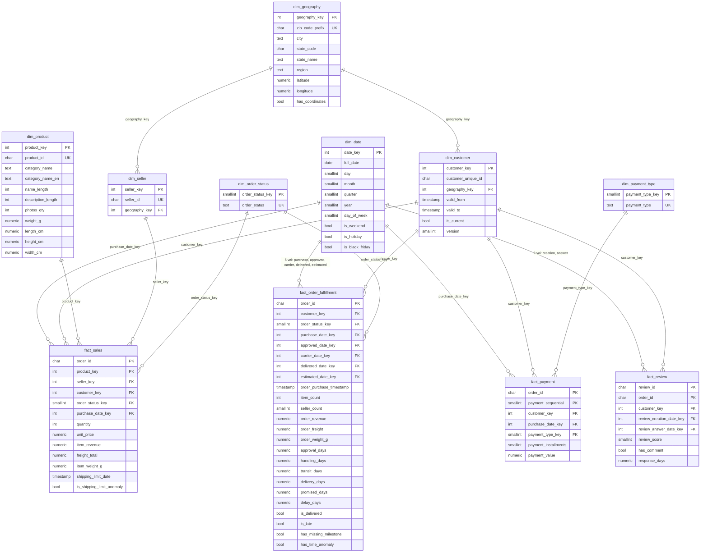

# Sơ đồ kho dữ liệu

Star schema, riêng nhánh địa lý tách bảng (`dim_geography` dùng chung cho khách và người bán). Chi tiết cột: [data_dictionary.md](../data_dictionary.md).

GitHub hiển thị sơ đồ Mermaid trực tiếp khi mở file này.

